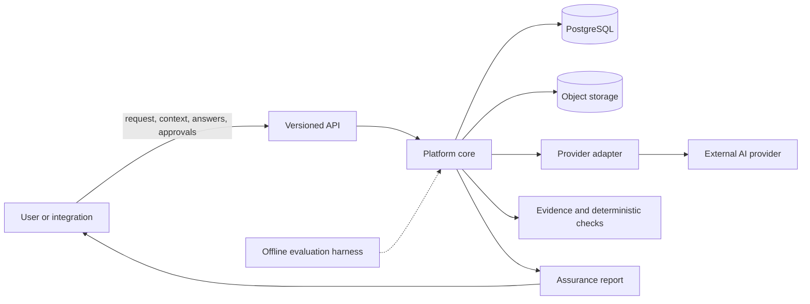
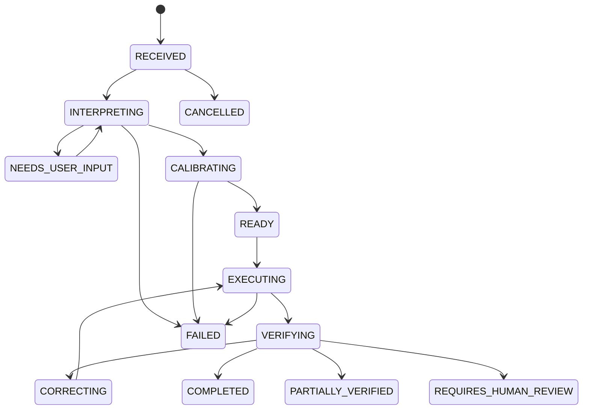

# Architecture

## Status and scope

This document turns the working baseline in
[`../universal_ai_platform_MASTER_SPECIFICATION.md`](../universal_ai_platform_MASTER_SPECIFICATION.md)
into an implementation-oriented architecture for the first prototype.
It is a starting design, not a claim that the proposed choices have been
validated in production. Revisit a decision when evidence or a material
constraint warrants it.

The product's defining responsibility is to preserve human intent,
orchestrate AI execution, and independently report how well the result
meets that intent. It is not just a prompt rewriter or a wrapper around a
single model.

## Architectural principles

- Preserve the original request independently of its interpretation.
- Keep approved, versioned intent as the source of acceptance criteria.
- Label explicit, inferred, assumed, and user-clarified requirements.
- Keep provider-specific behavior behind replaceable adapters.
- Separate generation from assurance; generated output is not its own
  evidence of correctness.
- Prefer deterministic checks when they are reliable, and expose
  uncertainty and unavailable checks.
- Persist consequential state transitions and their reasons.
- Treat uploaded and retrieved content as untrusted data, never as
  platform or user instructions.
- Keep critical acceptance requirements as hard gates, not weighted
  score contributions.
- Begin as a modular monolith. Extract services only when operational
  evidence justifies the cost.

## System context

The API and core are one deployable application at the start. PostgreSQL
is the durable system of record. Binary files are stored separately when
document ingestion is implemented. External model providers are
replaceable dependencies, not sources of truth for task state or
acceptance criteria.

## Logical modules and ownership

Keep modules in one application with explicit interfaces and narrow
dependencies:

| Module | Responsibility and owned concepts |
| --- | --- |
| `api` | Versioned HTTP contracts, request validation, error envelope, request IDs |
| `tasks` | Task lifecycle, ownership, cancellation, and persisted transitions |
| `context` | Source requests, context assets, metadata, and safe parsing boundaries |
| `intent` | Intent Record schema, provenance, immutable versions, requirement IDs |
| `clarification` | Material uncertainty, questions, answers, and labelled assumptions |
| `calibration` | Provider-neutral execution specification and requirement traceability |
| `orchestration` | Execution coordination, idempotency, bounded retries, and recovery |
| `providers` | Provider interface, registry, capability declarations, and adapters |
| `assurance` | Structural and requirement checks, hard gates, and verification statuses |
| `evidence` | Claims, sources, evidence links, and retrieval metadata |
| `correction` | Structured issues, targeted revisions, and bounded re-verification |
| `reporting` | User-facing results, limitations, and audit history |
| `security` | Authentication/authorization hooks, tenant scope, secret handling, retention |
| `evaluation` | Versioned benchmark cases, baseline runners, metrics, and regression tests |
| `domain_modules` | Optional academic, software, and creative checks implementing a shared contract |

Modules must not bypass the intent and task lifecycle to call providers
directly. Provider-specific request and response types remain inside
`providers`; the rest of the application uses canonical domain models.
Domain modules contribute checks through an explicit contract. The core
reports unsupported checks as unavailable, not passed.

## Primary workflow

1. **Receive:** validate the request, establish an owner/tenant scope,
   persist the unmodified source request, and create a task in `RECEIVED`.
2. **Interpret:** create a draft Intent Record with stable requirement
   IDs, source provenance, field-level uncertainty, and detected
   ambiguities or contradictions.
3. **Clarify:** ask only when resolving uncertainty is materially useful.
   Record answers and assumptions; a user-approved interpretation
   creates a new Intent Record version rather than overwriting history.
4. **Approve and calibrate:** use an approved Intent Record version to
   produce a concise execution specification. Every instruction and
   acceptance criterion links to source requirement IDs. Reject
   specifications that omit or alter mandatory requirements.
5. **Execute:** persist an execution attempt tied to the exact
   specification and intent version. Route through an adapter and
   normalize the response into an output envelope.
6. **Assure:** evaluate the output against the governing criteria using
   deterministic checks, evidence, tests, and model-assisted checks as
   appropriate. Keep output, claims, evidence, and verification results
   as distinct records.
7. **Correct or deliver:** create bounded, targeted correction attempts
   for eligible failures. Re-run affected and critical global checks.
   Deliver a report that distinguishes supported, contradicted,
   partially supported, unverified, not applicable, and human-review
   results.

### Initial assurance implementation

The first assurance slice accepts a text output only after the current
Intent Record is approved. `POST /v1/tasks/{task_id}/assurance` stores
the output and a report tied to that Intent Record version; `GET
/v1/tasks/{task_id}/assurance` returns the latest report, and the
associated output can be retrieved by its ID.

The deterministic checks currently supported by `verification_method`
are `contains_text:<literal>`, `section_present:<Markdown heading>`, and
`valid_json`. Unknown or absent methods are marked
`requires_human_review`; they are never treated as passing. Critical
mandatory requirements are reported as hard gates, so a failed gate
prevents `all_checks_passed`. That status means only that the implemented
checks passed. Every report states that semantic correctness and factual
accuracy are not established. Claim extraction, source verification,
execution, and correction are not implemented in this slice.

The implementation must define and test allowed transitions. Each
transition records timestamp, actor/component, prior and new state, and
reason. Provider timeouts are ambiguous outcomes: do not assume the
provider did not execute, and use idempotency and provider request IDs
where available. Retry and correction limits must be explicit.

## Data architecture

PostgreSQL is the proposed relational system of record. The first local
development slice defaults to SQLite so it can be run without external
services; migrations and SQLAlchemy models also support PostgreSQL.
SQLite is a development convenience, not a production or multi-tenant
deployment recommendation. Use relational columns for identity,
ownership, status, version, timestamps, and relationships; use JSONB for
validated, evolving domain payloads. Do not make the database an
unstructured document store.

Core records and invariants:

- **Task** owns the workflow and tenant/owner scope.
- **Source request** is preserved separately and is never rewritten by
  interpretation or execution.
- **Intent Record** is versioned; an approved version is immutable.
  Requirements carry stable IDs and provenance.
- **Clarification** links to the intent version and requirements it
  addresses.
- **Execution specification** records its source intent version,
  calibration version, content hash, and requirement traceability.
- **Execution** records the provider, attempt, status, input hash, and
  provider request identifier when available.
- **Output** is versioned and linked to its execution.
- **Claims, evidence, and verification results** are separate so a
  source's existence is not confused with support for a claim.
- **Correction issue** identifies failed criteria, output location,
  evidence, expected change, and re-verification plan.
- **Audit event** is append-only for consequential state changes.

Every tenant-owned record must be access-scoped in application
operations. Add database row-level security when the deployment and
connection model can enforce it reliably; it does not replace
application authorization tests. Store binary assets in object storage
with database metadata for tenant, checksum, MIME type, size,
classification, retention, scanning, and processing status. Defer
vector storage until a retrieval use case is demonstrated.

## Runtime and deployment shape

Start with one backend application organized by the modules above. A
web client can use the versioned API without sharing domain logic with
the server. Start with one external provider adapter and a mock adapter
for deterministic tests.

Keep task state durable even if execution is moved to a worker. Short,
bounded operations may run in the API process initially. Before adding
long-running research, code execution, or media tasks, introduce a
durable worker/queue mechanism with recovery, idempotency, and bounded
retries. Do not add a distributed service topology or vector database
without a measured need.

Candidate technologies from the specification:

- Python and FastAPI for the backend.
- PostgreSQL for relational data and JSONB payloads.
- S3-compatible object storage for uploaded and generated binary files.
- A durable task queue/workflow mechanism when asynchronous workloads
  require it.
- React/Next.js for a web interface when the first user-facing flow is
  implemented.
- pytest for unit, contract, integration, and evaluation tests.

These are candidates rather than irrevocable vendor choices. No
provider, authentication product, queue, or object-storage vendor is
selected by this architecture.

## Security and trust boundaries

- Authenticate callers and authorize every task and asset access using
  owner/tenant scope.
- Keep provider credentials in managed secrets, not source, database
  payloads, or logs.
- Minimize sensitive data sent to providers and select providers
  according to the applicable data-handling policy.
- Treat files, retrieved pages, and provider responses as untrusted
  inputs; validate and constrain their use.
- Do not allow external content or execution output to change approved
  intent, acceptance criteria, platform policy, or tenant scope.
- Avoid logging raw prompts, documents, credentials, or full provider
  payloads unless explicitly needed and protected.
- Require human approval for consequential external actions.
- Make retention and deletion cover database records, object storage,
  backups, and provider-side retention commitments.
- Keep generation and assurance logically separate. A second model
  alone is not proof of independent verification.

## Evaluation architecture

The evaluation harness is an offline module that runs versioned cases
against conventional prompting, prompt optimization, and the full
platform treatment. Keep development, validation, and holdout data
separate. Record provider/configuration versions and preserve results
subject to privacy controls. Report false positives and false negatives,
requirement precision/recall, clarification burden, calibration fidelity,
critical-gate failures, correction regressions, coverage, and
uncertainty. Do not advertise validated thresholds until benchmark
evidence supports them.

The current 20-case `0.1.0` set is development-only and explicitly marked
not adjudicated. Its evaluator reports strict normalized-text and
structured-field exact-match diagnostics, including breakdowns by domain
and difficulty; these are not semantic quality scores. Release benchmark
readiness is blocked until a holdout split, recorded human adjudication
and reviewer roles, complete expected acceptance criteria, adequate
failure-mode coverage, and ground-truth sources for citation-trap cases
are present. Legal cases additionally require reliable authoritative
sources and qualified legal reviewers.

The A/B/C comparison schema records dataset version, case/domain/difficulty,
repetition, condition, provider configuration, wall-clock and user-active
time, provider-reported token totals, clarification burden, mandatory
criterion outcomes, human adjudication, and verifier confusion counts.
Reports stratify condition summaries by domain and difficulty. A run counts
as a quality success only when it is adjudicated, human-accepted, and has at
least one mandatory criterion with all such criteria passing. Paired time or
token savings are reported only when both matched runs meet that bar; token
savings additionally require complete usage for both runs. Human acceptance,
quality success, and measurement coverage are reported separately.

This comparison code is not yet a controlled experiment runner. Before
collecting decision-quality results, freeze the case set and acceptance
criteria, use identical cases and repetitions across conditions, randomize
execution order where feasible, and record provider configurations. A
provider-call ledger must aggregate usage across every call, including retries
and assurance calls; unknown usage stays unknown. Apply the same adjudication
criteria to each condition and report unadjudicated cases. The present live
diagnostic records intent-extraction usage only. No end-to-end A/B/C data,
causal savings, confidence intervals, or significance tests are available.

## Suggested implementation sequence

1. Establish the project skeleton, API conventions, validation, and test
   tooling.
2. Define task and Intent Record models, including provenance,
   versioning, and source preservation.
3. Persist and retrieve tasks and immutable intent versions.
4. Add a small labelled development set for extraction and
   calibration tests.
5. Add contradiction detection and uncertainty representation.
6. Select a provider based on access, privacy, and task requirements;
   implement its adapter behind the extraction/provider contracts.
7. Add clarification, calibration, and durable execution state.
8. Add independent requirement/structural assurance and transparent
   reports.
9. Add source verification, bounded correction, document ingestion,
   evaluation baselines, and the first domain checks incrementally.

This sequence keeps the first milestone deliberately small: reliably
store and retrieve a validated, versioned Intent Record before building
the full AI workflow.

## Decisions to validate before implementation

| Decision | Starting recommendation | Validate against |
| --- | --- | --- |
| Backend and schema tooling | Python, FastAPI, Pydantic | Team capability, dependency support, deployment target |
| Persistence and migrations | PostgreSQL, relational ownership fields plus JSONB, migration tool | Local development and deployment constraints |
| Initial identity model | Explicit task owner; add organization memberships before multi-tenant use | Whether initial users are single-user, invited, or organization-based |
| Background work | Defer queue until a real long-running workflow; then select durable queue/workflow mechanism | Expected task duration, retry/recovery semantics, operations capacity |
| File storage | S3-compatible object storage when binary ingestion begins | Local development, target hosting, retention and residency requirements |
| Provider | One adapter selected for access, quality, privacy, and supported output contracts | Data-handling terms, availability, structured output, evaluation results |
| Web client | Separate client over versioned API; defer framework choice until UI work | Product interaction needs and team skills |
| Retrieval/vector index | Do not include initially | Demonstrated retrieval need and measurable benefit |

The next architecture decisions should be made from repository and
deployment constraints before implementation, rather than treated as
implicit commitments in this document.
